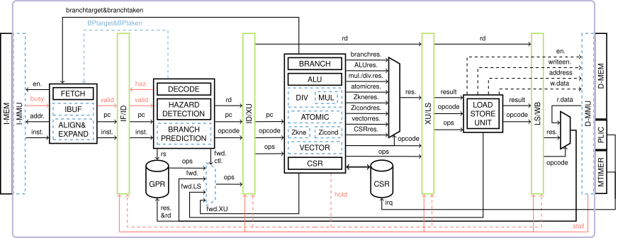

# RS5 Documentation

This folder contains documentation for RS5 implementation, extensions and parameters.
For a general overview of the processor, see the [main README](../README.md).

## Table of Contents

- [RS5 Documentation](#rs5-documentation)
  - [Table of Contents](#table-of-contents)
  - [Architecture Overview](#architecture-overview)
  - [Processor interface](#processor-interface)
  - [Extensions](#extensions)
  - [Parameters](#parameters)

---

## Architecture Overview

RS5 has a 4-stage pipeline.

    

| Stage | Module | Description |
|---|---|---|
| Fetch | [fetch](../rtl/fetch.sv) | Program counter logic, instruction memory access |
| Decode | [decode](../rtl/decode.sv) | Instruction decoding, register file read, data hazard detection |
| Execute | [execute](../rtl/execute.sv) | ALU, branch, CSR access |
| Load/Store | [RS5 (top-level)](../rtl/RS5.sv) | Memory access |

| Option | Module | Description |
|---|---|---|
| IBUF / ALIGN & EXPAND | [fetch](../rtl/fetch.sv)/[decompresser](../rtl/decompresser.sv) | Memory alignment control and instruction buffering for compressed instructions support |
| BRANCH PREDICTION | [fetch](../rtl/fetch.sv)/[decode](../rtl/decode.sv)/[execute](../rtl/execute.sv) | Static branch prediction for immediate-target branch resolution in decode stage instead of execute stage |
| Extensions | [execute](../rtl/execute.sv) and several others | Most extensions use the **hold** signal to perform multi-cycle operations |
| MMU | [mmu](../rtl/mmu.sv) | Implement the Xosvm extension |

**Hazard handling:** data and control hazards insert bubbles; a slow instruction memory also inserts bubbles; a slow data bus stalls the pipeline, although instruction fetch can still occur through *IBUF*.

---

## Processor interface

The top-level module [RS5](../rtl/RS5.sv) provides the parameter configuration and the RS5 interface.
The interface contains four signal groups:

* Global signals: `clk`, `reset_n` (asynchronous), and `sys_reset_i` (synchronous);
* Instruction memory: OBI read-only manager, `instr_*` signals;
* Data bus: OBI manager, `data_*` signals;
* Peripherals: `tip_i` for timer interrupts, `eip_i` for external interrupts optionally managed through PLIC, `interrupt_ack_o`, and `mtime_i` for optional cycle counter through MTIMER/RTC.

### OBI interfaces

Both memory interfaces follow the [OpenHW OBI](https://github.com/openhwgroup/obi) protocol: an address phase (`req`/`gnt`) and an in-order response phase (`rvalid`), without `rready`.

| Signal | Direction | Width | Description |
|---|---|---|---|
| `instr_req_o` | out | 1 | Instruction fetch request |
| `instr_gnt_i` | in | 1 | Fetch request accepted |
| `instr_addr_o` | out | 32 | Word-aligned fetch address |
| `instr_rvalid_i` | in | 1 | Fetch response valid |
| `instr_rdata_i` | in | 32 | Fetched word |
| `data_req_o` | out | 1 | Load/store request |
| `data_gnt_i` | in | 1 | Load/store request accepted |
| `data_addr_o` | out | 32 | Word-aligned data address |
| `data_we_o` | out | 1 | Write enable (1: store, 0: load) |
| `data_be_o` | out | `BUS_WIDTH/8` | Byte enables, for loads and stores |
| `data_wdata_o` | out | `BUS_WIDTH` | Store data |
| `data_rvalid_i` | in | 1 | Load/store response valid |
| `data_rdata_i` | in | `BUS_WIDTH` | Load data |

* Once asserted, `req` and the address phase signals hold until `gnt`. A request is never withdrawn, even when a jump makes a fetch unnecessary: its response is discarded.
* `rvalid` may arrive any number of cycles after `gnt`, at least one. Every granted request, loads and stores alike, receives exactly one `rvalid`, in order.
* The data interface keeps at most two requests without response: its next request may be granted while it waits for the previous response. The instruction interface keeps up to the *IBUF* size (see `IMEM_LATENCY`) requests without response.
* A memory that grants every request and answers in the next cycle (e.g., a BRAM with `gnt = 1` and `rvalid` as the registered `req && gnt`) runs the core exactly as fast as with zero wait states.
* While the data interface waits for `gnt` or `rvalid`, the pipeline stalls. Fetch continues until *IBUF* is full.
* With `BUS_WIDTH` > 32, the byte lanes are relative to the word in `data_addr_o`, as used by the vector unit.
* `instr_req_o` and `data_req_o` are driven from registers only: they never depend combinationally on any `gnt` or `rvalid` input, of either interface. A subordinate or arbiter may therefore compute `gnt` from `req` freely.
* There are no `err`, `atop` or `exokay` signals yet: atomics are performed by the core as a load followed by a store.

---

## Extensions

Extensions are enabled via parameters in [../rtl/RS5.sv](../../rtl/RS5.sv).

| Extension | Parameter | Description | Docs |
|---|---|---|---|
| Zicsr | always enabled | Control and status register access | — |
| M | `MULEXT = MUL_M` | Integer multiply and divide | — |
| Zmmul | `MULEXT = MUL_ZMMUL` | Multiply-only subset of M | — |
| A | `AMOEXT = AMO_A` | Atomic memory operations | — |
| Zaamo | `AMOEXT = AMO_ZAAMO` | AMO subset of A | — |
| Zalrsc | `AMOEXT = AMO_ZALRSC` | LR/SC subset of A | — |
| C | `COMPRESSED = 1` | Compressed (16-bit) instructions | — |
| Zcb | `ZCBEnable = 1` | Additional compressed instructions (requires C) | — |
| Zicond | `ZICONDEnable = 1` | Integer conditional operations | — |
| Zihpm | `HPMCOUNTEREnable = 1` | Hardware performance-monitoring counters | — |
| Zbkb | `ZBKBEnable = 1` | Bit-manipulation for cryptography | — |
| Zkne | `ZKNEEnable = 1` | AES encryption (scalar, 32-bit) | — |
| Zknh | `ZKNHEnable = 1` | SHA2 hash function instructions | — |
| Zve32x | `VEnable = 1` | Vector extension (configurable VLEN, LLEN) | — |
| Xosvm | `XOSVMEnable = 1` | Offset and size virtual memory (non-standard) | [Xosvm.md](extensions/Xosvm.md) |

---

## Parameters

Non-extension parameters configure processor behaviour and target environment.

| Parameter | Type | Default | Description |
|---|---|---|---|
| `Environment` | `environment_e` | `ASIC` | Target technology: `ASIC` or `FPGA` (selects LUT-RAM register bank on FPGA) |
| `START_ADDR` | `logic [31:0]` | `0x00000000` | Reset/boot address loaded into the program counter on reset |
| `BUS_WIDTH` | `int` | `32` | Data bus width in bits |
| `IMEM_LATENCY` | `int` | `1` | Cycles from `instr_gnt_i` to `instr_rvalid_i` of a typical fetch (1: the next cycle). It sizes the instruction buffer and the fetch requests kept in flight to the smallest power of 2 above `IMEM_LATENCY + 1`: 4 for latency 1–2, 8 for latency 3–6, 16 for latency 7–14. A larger value never slows a faster memory, it only costs one buffer entry (32 flip-flops) per word |
| `BRANCHPRED` | `bit` | `1` | Enable static branch prediction (resolves immediate-target branches at decode instead of execute) |
| `FORWARDING` | `bit` | `1` | Enable data forwarding from execute result and memory read; writeback forwarding is always active |
| `VLEN` | `int` | `256` | Vector register length in bits (effective when `VEnable = 1`) |
| `LLEN` | `int` | `32` | Vector Lane width in bits, number of bits each lane process, smaller values indicate more lanes and thus more parallelism (effective when `VEnable = 1`) |
| `DEBUG` | `bit` | `0` | Dump register file contents to `DBG_REG_FILE` at end of simulation |
| `DBG_REG_FILE` | `string` | `./debug/regBank.txt` | Output path for register file debug dump |
| `PROFILING` | `bit` | `0` | Enable instruction profiling report written to `PROFILING_FILE` |
| `PROFILING_FILE` | `string` | `./debug/Report.txt` | Output path for profiling report |

